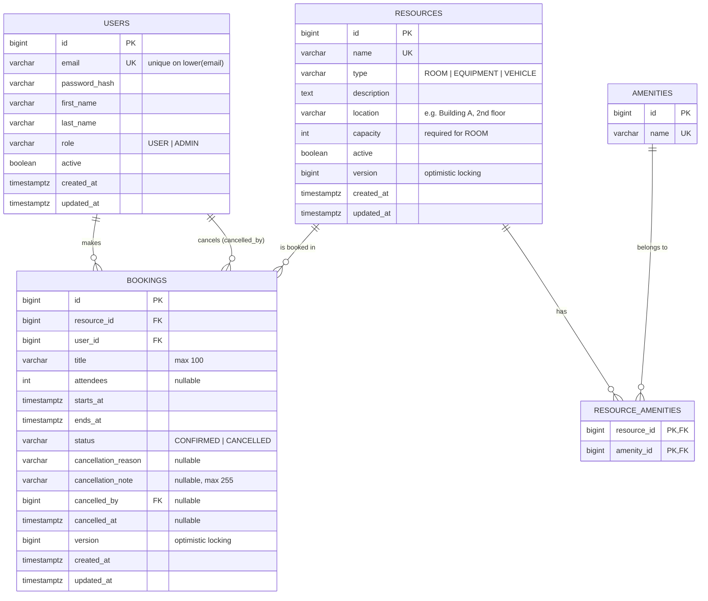
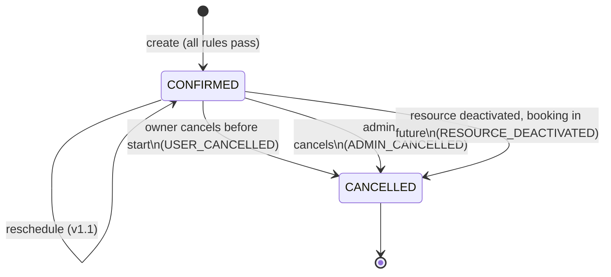

# Domain Model

> Phase 1 · Source of truth for entities, relationships and database constraints.
> Related: [requirements](requirements.md) · [API contract](api.md) · [ADRs](adr/)

## 1. Aggregates

| Aggregate | Responsibility | Key invariants |
|---|---|---|
| **User** | Identity, role, login credentials | Unique e-mail (case-insensitive); inactive users cannot log in |
| **Resource** | Bookable item (room, equipment, vehicle) with its amenities | Rooms must have capacity > 0; inactive resources accept no bookings (BR-07) |
| **Booking** | Reservation of a resource by a user for a time range | No overlap of `CONFIRMED` bookings per resource (BR-01); `starts_at < ends_at`; status transitions are one-way |

`Amenity` is a simple dictionary entity (e.g. *Projector*, *Whiteboard*, *Video conferencing*), referenced by rooms.

## 2. Entity-relationship diagram



## 3. Enumerations

| Enum | Values | Notes |
|---|---|---|
| `Role` | `USER`, `ADMIN` | |
| `ResourceType` | `ROOM`, `EQUIPMENT`, `VEHICLE` | Drives max duration (BR-04) and office-hours rule (BR-10) |
| `BookingStatus` | `CONFIRMED`, `CANCELLED` | `CANCELLED` is terminal |
| `CancellationReason` | `USER_CANCELLED`, `ADMIN_CANCELLED`, `RESOURCE_DEACTIVATED` | Required when status = `CANCELLED` |

Enums are stored as `varchar` with a `CHECK` constraint (not native PostgreSQL enums), so adding a value is a simple migration.

## 4. Booking lifecycle



## 5. Database constraints

Business rules enforced by the database itself, as the last line of defence:

| Rule | Constraint |
|---|---|
| BR-01 no overlap | `EXCLUDE USING gist (resource_id WITH =, tstzrange(starts_at, ends_at, '[)') WITH &&) WHERE (status = 'CONFIRMED')`, requires the `btree_gist` extension. See [ADR-001](adr/001-overlap-prevention-exclusion-constraint.md). |
| BR-02 valid range | `CHECK (ends_at > starts_at)` |
| Cancellation consistency | `CHECK ((status = 'CANCELLED') = (cancellation_reason IS NOT NULL AND cancelled_at IS NOT NULL))` |
| Room capacity | `CHECK (type <> 'ROOM' OR (capacity IS NOT NULL AND capacity > 0))` |
| Attendees | `CHECK (attendees IS NULL OR attendees > 0)` |
| Unique e-mail | `CREATE UNIQUE INDEX ux_users_email ON users (lower(email))` |

Rules validated **only in the application** (they depend on configuration or the current time): BR-03 not in the past, BR-04 max duration, BR-05 booking horizon, BR-06 attendees ≤ capacity, BR-07 resource active, BR-10 office hours.

## 6. Indexes

| Index | Purpose |
|---|---|
| GiST index created by the exclusion constraint | Overlap checks, calendar queries per resource |
| `bookings (user_id, starts_at)` | "My bookings" (upcoming/past) |
| `bookings (resource_id, starts_at) WHERE status = 'CONFIRMED'` | Deactivation impact, admin filters |

## 7. Configuration (not stored in DB in MVP)

```yaml
booking:
  zone: Europe/Warsaw
  office-hours:
    days: [MONDAY, TUESDAY, WEDNESDAY, THURSDAY, FRIDAY]
    start: "07:00"
    end: "20:00"
  slot-minutes: 15          # BR-02 granularity and minimum
  horizon-days: 90          # BR-05
  max-duration:             # BR-04
    ROOM: 8h
    EQUIPMENT: 5d
    VEHICLE: 5d
```

Bound to a `@ConfigurationProperties` record, so the values are type-safe and easy to override in tests.
