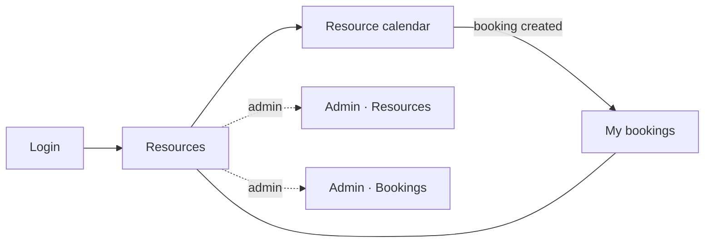

# UI Screens

> Phase 1 · Screen inventory, routes, components and the API calls behind each screen. Wireframes in `docs/wireframes/`.

The frontend is a React single-page app (Vite, JavaScript/JSX, React Router with clean URLs), built into the Spring Boot jar ([ADR-005](adr/005-react-spa-built-into-spring-boot-jar.md)).

| # | Screen | Route | Guard | Main elements | API calls | Stories |
|---|---|---|---|---|---|---|
| S1 | Login | `/login` | Guest only | E-mail, password, demo account hints | `POST /auth/login` | US-01 |
| S2 | Resources | `/resources` | Auth | Cards, filters: type, min. capacity, amenities (filters kept in URL query params) | `GET /resources`, `GET /amenities` | US-05 |
| S3 | Resource calendar | `/resources/:id?week=2026-10-12` | Auth | Details panel; `WeekCalendar` Mon–Fri 7:00–20:00; busy slots show title + booker with `mailto:`; own bookings highlighted; click free slot → `BookingDialog` | `GET /resources/{id}`, `GET /resources/{id}/bookings`, `POST /bookings` | US-06, US-07, US-08 |
| S4 | My bookings | `/my-bookings?tab=upcoming` | Auth | Tabs Upcoming/Past, cancel with inline confirmation | `GET /bookings/me`, `POST /bookings/{id}/cancel` | US-09, US-10 |
| S5 | Admin · Resources | `/admin/resources` | Admin | Table incl. inactive, create/edit panel, `DeactivateDialog` with impact count | `GET/POST/PUT /admin/resources`, `GET .../deactivation-impact`, `POST .../deactivate`, `POST .../activate` | US-13 |
| S6 | Admin · Bookings | `/admin/bookings` | Admin | Filterable, paginated table (filters in URL) | `GET /admin/bookings` | US-14 |

Unknown routes render a `NotFound` page. Deep links and refresh work thanks to the server-side SPA fallback (ADR-005).

## Component tree

```
<App>
  <QueryClientProvider>          TanStack Query
    <AuthProvider>               token in sessionStorage, current user, login/logout
      <ToastProvider>
        <Router>
          /login                 <LoginPage>
          <RequireAuth>          redirects to /login, remembers the target URL
            <AppLayout>          <TopBar> + <Outlet>
              /resources         <ResourcesPage>       <ResourceFilters> <ResourceCard>*
              /resources/:id     <ResourceCalendarPage> <ResourceDetails> <WeekCalendar> <BookingDialog>
              /my-bookings       <MyBookingsPage>      <BookingList> <CancelConfirm>
              <RequireAdmin>     403 view for non-admins
                /admin/resources <AdminResourcesPage>  <ResourceTable> <ResourceForm> <DeactivateDialog>
                /admin/bookings  <AdminBookingsPage>   <BookingFilters> <BookingTable> <Pagination>
```

## Key components

| Component | Responsibility | Notes |
|---|---|---|
| `WeekCalendar` | Renders a Mon–Fri grid for office hours and positions bookings | Pure, presentational: props `weekStart`, `bookings`, `officeHours`, `slotMinutes`, `onSlotClick`, `onBookingClick`. Position = minutes from day start → `top`/`height`. Unit-tested without the API |
| `BookingPopover` | Details of a busy slot: title, time, booker, `mailto:` link | BR-12 |
| `BookingDialog` | Booking form (title, attendees, date, start, end) | React Hook Form + zod schema `bookingSchema` mirroring BR-02/03/06/10. Maps API `code` (e.g. `BOOKING_CONFLICT`) to a form-level error |
| `DeactivateDialog` | Shows "N upcoming bookings will be cancelled", then deactivates | Loads `deactivation-impact` when opened |
| `TopBar` | Navigation, user name, logout | Admin links only for `ADMIN` |

## Data layer

- `api/client.js`: `fetch` wrapper. Adds `Authorization`, parses `ProblemDetail` into an `ApiError` class (`status`, `code`, `detail`, `errors`), and on 401 clears the token and redirects to `/login`. All HTTP calls go through this module.
- One hooks module per feature (`useResources`, `useResourceBookings`, `useCreateBooking`, …). Query keys:

| Query key | Invalidated by |
|---|---|
| `['resources', filters]` | resource create/update/(de)activate |
| `['resource-bookings', resourceId, weekStart]` | create or cancel booking, deactivate resource |
| `['my-bookings', tab]` | create or cancel booking |
| `['admin-bookings', filters]` | any booking change |

- `lib/time.js`: formatting in `Europe/Warsaw` (`Intl.DateTimeFormat`) and building ISO strings with offset for requests ([ADR-003](adr/003-time-handling.md)).

## Shared UI

- **Toasts:** success and error messages; error text mapped from the API `code`.
- **Dialogs:** native `<dialog>` element wrapped in a `Dialog` component (focus trap, `Esc` to close).
- **Styling:** CSS Modules plus a small `tokens.css` (colors, spacing, radii) matching the wireframes.

## Navigation


